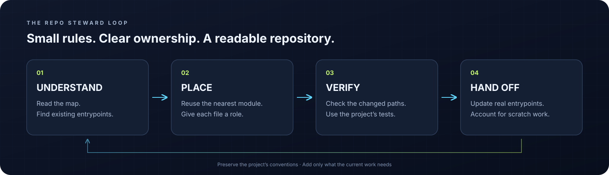

<p align="center">
  
</p>

<h1 align="center">🧭 Repo Steward</h1>

<p align="center">
  <strong>让 AI 放手开发，也让人类看得懂项目。</strong><br>
  为论文复现、算法开发和单人科研项目准备的轻量仓库治理 Skill。
</p>

<p align="center">
  <a href="https://github.com/JW36D/repo-steward/actions/workflows/ci.yml"></a>
  
  
  <a href="https://agentskills.io/specification"></a>
  <a href="LICENSE"></a>
</p>

<p align="center">
  <a href="#-为什么需要它">为什么需要它</a> ·
  <a href="#-开始使用">开始使用</a> ·
  <a href="#-四个命令">四个命令</a> ·
  <a href="#-为科研项目留出位置">科研适配</a> ·
  <a href="#-能力边界">能力边界</a>
</p>

---

## 🌀 为什么需要它

AI 一下午写完了实验，项目里也多出了 `train_v2_final.py`、几个不知用途的调试脚本、重复的方案说明，以及混进源码的模型权重。

下次接着做时，人类需要重新问一遍：“入口在哪？该改哪个模块？哪份文档才是当前版本？”

**Repo Steward 把这些问题前移到开发过程中：新文件有归属，现有文件有入口，临时材料有去向。**

<p align="center">
  
  <br><sub>概念插画，用于说明组织方式；不代表经过测量的效率提升。</sub>
</p>

| 开发中的问题 | Repo Steward 的处理方式 |
| --- | --- |
| 想加功能，却直接再写一套实现 | 先找现有入口和相近实现，再决定扩展或新建 |
| 一个文件不知道属于哪里 | 按职责、现有模块和框架约定选择位置 |
| README 越写越多，入口反而不清楚 | 维护现有导航，每类当前事实有权威位置 |
| 数据、权重和运行结果混入源码 | 区分维护输入、外部载荷、可再生产物与临时工作 |
| 改名之后文档仍指向旧文件 | 检查受影响的普通 Markdown 本地链接 |
| 为了整理项目，又增加一堆规范 | 小项目按需启用；没有需要就不增加文件和流程 |

## ✨ 它由什么组成

**一套可复用的工作约定，加一个无需第三方依赖的命令行工具。**

| 部分 | 负责什么 |
| --- | --- |
| [`SKILL.md`](SKILL.md) | AI 在初始化、开发、整理与交接时采用的决策流程 |
| [`scripts/repo_steward.py`](scripts/repo_steward.py) | 有界目录清单、增量检查、策略初始化和路径查找 |
| [`references/python-research.md`](references/python-research.md) | Python 科研、具身智能、仿真与算法实验的文件生命周期 |
| [`references/policy-and-cli.md`](references/policy-and-cli.md) | CLI 参数、策略格式、检查范围与限制 |
| [`tests/`](tests/) | 使用独立临时仓库验证真实行为的 28 项测试 |

<p align="center">
  
</p>

## 🚀 开始使用

### 在 Codex 中安装

将仓库克隆为个人 skill。目标目录应该尚不存在，Git 会拒绝覆盖已有安装：

```bash
git clone https://github.com/JW36D/repo-steward.git \
  "${CODEX_HOME:-$HOME/.codex}/skills/repo-steward"
```

在能够发现新 skill 的 Codex 会话中调用：

```text
$repo-steward 初始化当前科研项目，保留上游布局，建立必要的项目导航和文件归属规则。
```

已有项目也可以先做一次审计：

```text
$repo-steward 检查当前项目的入口、文档和实验产物归属，给出带路径依据的改进建议。
```

开发任务中使用：

```text
$repo-steward 为当前策略增加一个消融实验，沿用已有配置和输出目录，结束时检查新增文件与导航。
```

Skill 使用标准 `SKILL.md` 格式。其他支持 Agent Skills 的客户端可按各自的安装方式加载；不同客户端的发现、触发和工具执行能力需要分别确认。

### 只用 CLI 也可以

要求 **Python 3.10+**；`check` 还需要 Git。运行时无需 `pip install`，也无需模型、API key 或网络服务。下面示例在仓库根目录运行：

```bash
# 只读审计
python3 scripts/repo_steward.py audit --root /path/to/project

# 找训练入口；同时支持部分中文别名，例如“配置”“数据”“权重”
python3 scripts/repo_steward.py locate train --root /path/to/project
```

## 🧰 四个命令

| 命令 | 何时使用 | 是否写入项目 |
| --- | --- | --- |
| `audit` | 看当前布局、入口、文件角色和问题清单 | 否 |
| `init` | 根据已有结构预览项目策略 | 默认否；`--write` 仅新建策略文件 |
| `check` | 检查当前 Git 变更、未忽略的新文件及相关链接影响 | 否 |
| `locate` | 通过名字、角色或别名查路径 | 否 |

```bash
# 先预览，再按需要写入；不会覆盖已有策略
python3 scripts/repo_steward.py init --root /path/to/project --profile python-research
python3 scripts/repo_steward.py init --root /path/to/project --profile python-research --write

# 当前工作区相对 HEAD 的变更
python3 scripts/repo_steward.py check --root /path/to/project

# 将警告也作为失败；或比较某个已存在的提交/分支
python3 scripts/repo_steward.py check --root /path/to/project --strict
python3 scripts/repo_steward.py check --root /path/to/project --base main --json
```

`init --write` 只创建 `.repo-policy.json`。README、agent 指令、ignore 规则和结构调整，由 AI 在具体任务范围内结合项目证据处理。

<details>
<summary><strong>🔎 检查结果和退出码</strong></summary>

`check`：`0` 表示没有 error；`1` 表示存在 error，或 `--strict` 下存在 warning；`2` 表示输入错误或清单不完整。`audit` 是诊断命令，发现问题仍返回 `0`，输入错误或清单不完整返回 `2`。`locate` 无匹配返回 `1`。

| 常见发现 | 默认级别 | 含义 |
| --- | --- | --- |
| `tracked-payload` | error | 数据、权重、输出、缓存等已进入 Git，需核实是否为有意维护的输入 |
| `broken-local-link` | error | 普通 Markdown 本地链接的目标不存在 |
| `root-entry` | warning | 顶层新条目尚未纳入约定 |
| `scratch-location` | warning | 临时/备份候选文件出现在临时区之外 |
| `payload-location` | warning | 疑似载荷文件出现在对应区域之外 |
| `scan-incomplete` | warning + 退出码 2 | 达到扫描上限或遇到 I/O 问题，不能当作完整通过 |

默认最多查看 10,000 个工作区条目，并为 Git 跟踪清单设置相同数量上限。可使用 `--max-entries` 调整。大型载荷目录作为边界呈现，不读取数据集或模型内容。

完整说明见 [Policy & CLI reference](references/policy-and-cli.md)。

</details>

## 🤖 为科研项目留出位置

Python research 适配器面向论文复现、机器人与仿真、模型算法和实验开发。它关注文件的实际用途：

| 文件 | 管理方式 |
| --- | --- |
| `models/policy.py`、数据加载器 | 维护源码，保留已有模块边界 |
| 配置模板、训练与评估入口 | 可复用输入，说明真实运行命令 |
| URDF、Xacro、MJCF、mesh、场景文件 | 可能是必要资产，核实用途和引用 |
| 数据集、录制包、checkpoint | 外部或实验载荷，记录来源与版本 |
| 日志、视频、评估结果、配置快照 | 运行输出，按已有 run 系统保存 |
| 小型测试 fixture、快照 | 可以有意进入版本控制 |
| 一次性调试脚本 | 约定临时区；任务结束时确认保留、删除或转正式 |

对于有价值的实验，复用已有 logger/config，保留代码修订、命令、随机种子、数据/权重身份、输出位置和评估协议。让下一次复现有依据。

### 策略按项目生长

无需强行使用某棵目录树。可以从 [Python research 示例策略](examples/python-research.policy.json) 开始，再按已有布局调整：

```json
{
  "schema_version": 1,
  "profile": "python-research",
  "root_entries": ["README.md", "train.py", "robot_policy", "configs", "data", "runs"],
  "paths": {"source": ["robot_policy/**"]},
  "exceptions": [
    {
      "rule": "tracked-payload",
      "path": "assets/reference-policy.pt",
      "reason": "A small published reference checkpoint required by the example"
    }
  ]
}
```

例外绑定到明确的规则和精确路径，并记录原因。它不会顺便放行该目录未来新增的其他权重。

## 🧠 保持轻量的几个决定

- **顺应已有项目。** 优先保留框架发现规则、上游复现布局和命令入口。
- **按需读取。** Skill 主文件放决策，科研细节与 CLI 细节按任务加载。
- **维护现有入口。** 导航随入口、职责或命令变化更新，普通小修无需新增总结文档。
- **让程序检查明确规则。** 语义重复、设计优劣、是否废弃等问题，仍然需要结合证据判断。
- **先理解，再清理。** 文件年龄、没有搜到引用、目录名字，都不能单独证明材料可以删除。

## 🧪 验证

```bash
python3 -B -m unittest discover -s tests -v
```

当前 28 项测试已在 Linux / Python 3.10 和 3.12 上通过，覆盖：

- 模型源码、机器人资产与小型 fixture 的识别；
- 被 Git 跟踪的 checkpoint、未跟踪的新文件、自定义数据区域；
- 删除或改名后受影响的 README 链接；
- 符号链接边界、扫描上限、无 Git 目录和空仓库；
- 初始化仅写一个策略文件，以及已有文件保护。

GitHub Actions 配置提供相同的 Python 3.10 / 3.12 测试矩阵；实际远程状态以页面上的 CI 结果为准。

## 🪟 能力边界

这是 **v0.1.0** 的轻量工具，当前以 Linux 小型科研仓库为主要验证环境。

- Skill 的触发和执行依赖客户端；若要阻止违规进入主分支，还需自行配置必需 CI。
- `check` 的发现范围围绕 Git 变更；它仍会建立有界文件清单。Git 忽略的本地输出可用 `audit` 查看边界。
- 大型数据、环境、缓存和 vendor 目录可能被跳过；跟踪清单中的载荷文件名仍会接受检查。目录符号链接不递归展开。
- Markdown 检查覆盖普通行内本地链接，不覆盖标题锚点、reference-style、HTML 链接或完整 Markdown 语法。
- 检查通过不能证明代码依赖正确、实验有效、模型成功率达标，或发布包完整。
- 节省查找时间和上下文成本是设计目标，目前没有足够的对照实验来承诺具体提升比例。

## 🌍 English overview

**Repo Steward** is an Agent Skill and dependency-free Python CLI for keeping small research repositories understandable. It helps coding agents decide where files belong, maintain human navigation, separate source inputs from experimental payloads, and close out changes cleanly. The Python research adapter covers reproduction, embodied AI, simulation, checkpoints, datasets, and run outputs. Its four commands are `audit`, `init`, `check`, and `locate`. Existing project conventions come first; deterministic checks cover explicit rules, while architectural and scientific judgments remain contextual.

## 🎨 视觉与许可

封面与概念插画由 AI 生成，流程图为 SVG。视觉用途和生成提示词保存在 [visual-prompts.md](docs/visual-prompts.md)。

项目采用 [MIT License](LICENSE)。欢迎通过 [Issues](https://github.com/JW36D/repo-steward/issues) 提供真实项目中的误报、缺失场景和改进建议。
